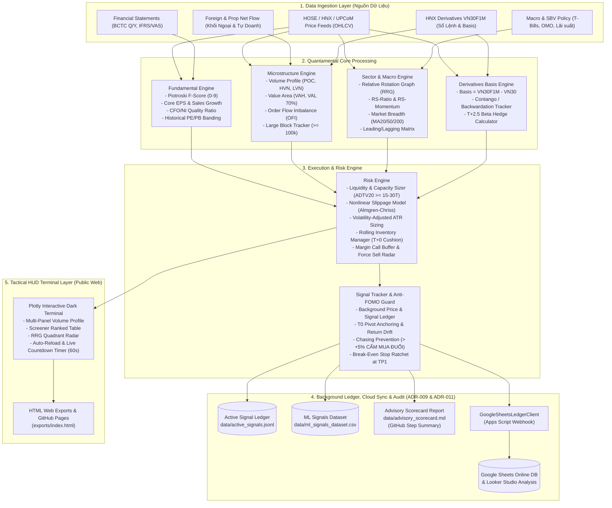

# Architecture: Neiro-Stock-VN Architecture Overview

## 1. Toàn Cảnh Kiến Trúc Hệ Thống (System Architecture)

Neiro-Stock-VN được thiết kế theo mô hình kiến trúc phân lớp độc lập (Layered Decoupled Architecture), tối ưu hóa cho môi trường vận hành nhẹ (< 15MB), không yêu cầu hạ tầng server cồng kềnh, chạy mượt mà trên cả máy tính cá nhân lẫn môi trường CI/CD Cloud (GitHub Actions / Colab).

---

## 2. Chi Tiết Các Tầng Xử Lý (Layer Breakdown)

### 2.1. Tầng Thu Thập & Chuẩn Hóa Dữ Liệu (`src/collector/`)
- **`vn_market_client.py`:** Đầu mối tích hợp API chuẩn hóa dữ liệu từ các nền tảng tài chính Việt Nam (VNDirect, Vietstock, TCBS, SSI, FiinTrade hoặc thư viện mã nguồn mở `vnstock`). Hỗ trợ cơ chế failover dự phòng và mock benchmark data cho unit tests.
- **`data_loader.py`:** Làm sạch dữ liệu, xử lý các sự kiện chia tách cổ tức, tăng vốn, thưởng cổ phiếu; chuyển đổi cấu trúc BCTC chuẩn VAS về dataclasses định lượng nhất quán.
- **`fialda_scanner.py`:** Khai thác chuyên sâu hệ thống **Fialda VIP Expert & Swagger API** (529 endpoints):
  - Tự động xác thực JWT Token (`/api/TokenAuth/Authenticate`) với chu kỳ hiệu lực 24 giờ.
  - **Cơ chế Chuẩn hóa Bí Mật & Lọc Ký Tự Ẩn (ADR-007):** Tự động loại bỏ khoảng trắng, dấu xuống dòng ẩn (`\r\n`) và ngoặc kép ngoài từ biến môi trường CI/CD, ngăn ngừa hoàn toàn lỗi xác thực giả.
  - **Hệ thống Cảnh báo Đa Tầng & Fallback An Toàn (ADR-005 & ADR-007):** Khi Fialda API gián đoạn, tự động phát cảnh báo rõ ràng và kích hoạt luồng fallback lấy giá Real-time công khai (Entrade/DNSE) kết hợp dữ liệu BCTC dự phòng, đảm bảo Dashboard không bao giờ sập.
  - Thu thập tín hiệu AI Expert: Chờ Mua Chân Sóng (`GetTinHieuChoMuaNew`), Đột biến Giá trị giao dịch (`GetTinHieuDotBienGiaTri`).
  - Trích xuất bộ chỉ số định chế IBD O'Neil: Sức mạnh giá RS 1 tháng (`rS1M`), Điểm tổng hợp (`compositeRating`), Hệ số Tích lũy/Phân phối (`accDissRating`).
  - Nạp toàn bộ ma trận luân chuyển dòng tiền RRG 1,530 mã toàn thị trường (`GetRRGData`).
  - Lọc đa biến chọn lọc **Top 20 Siêu cổ phiếu bứt phá chân sóng** (khung 1 tháng, biên lợi nhuận kỳ vọng $+20\% - +35\%$, cắt lỗ chặt chẽ $-5.5\%$).
- **`ranking_history.py`:** Bộ theo dõi và lưu trữ lịch sử xếp hạng chuỗi thời gian (Ranking History Tracker):
  - Ghi nhận snapshot Top N vào `data/ranking_history.jsonl` với cơ chế Rolling Window tự động cắt tỉa (tối đa 500 bản ghi $\sim 35\text{ KB}$, Zero-Waste $< 15\text{MB}$).
  - Cơ chế **Session Debounce 30 phút**: tự động nhận diện các lần quét liên tiếp trong cùng phiên để tránh làm nhiễu dữ liệu, duy trì mốc so sánh với phiên giao dịch liền trước thực tế.
- **`google_sheets_client.py` (`GoogleSheetsLedgerClient` - ADR-011):** Đồng bộ Sổ Cái Trực Tuyến & Dữ Liệu Machine Learning:
  - Đồng bộ tự động 100% lên **Google Sheets** qua cơ chế Google Apps Script Webhook siêu nhẹ (< 100 dòng code, chỉ dùng `requests` có sẵn, 0 MB cài đặt ngoài).
  - Tự động ghi nhận toàn bộ Feature Vector tại $T_0$ và cập nhật diễn biến giá theo chu kỳ $T+2.5$ đến $T+20$ phục vụ phân tích trực quan qua **Google Looker Studio** và huấn luyện mô hình Machine Learning.
  - Khiên chắn cách ly kiểm thử (`PYTEST_CURRENT_TEST`): Ngăn ngừa 100% dữ liệu mock từ unit tests làm sai lệch lịch sử xếp hạng thực tế.
  - Tính toán biến động thứ hạng ($\Delta Rank$): thăng hạng `↗ +N`, tụt hạng `↘ -N`, giữ hạng `=`, hoặc bứt phá mới `🆕 MỚI`.

### 2.2. Tầng Định Lượng Cơ Bản (`src/fundamental_engine/`)
- **`screener.py`:** Bộ lọc đa biến lọc ra Top $10\% - 15\%$ doanh nghiệp chất lượng cao nhất toàn sàn:
  - Lọc sơ bộ vốn hóa: Market Cap $\ge 1,000$ tỷ VND, Khối lượng trung bình 20 phiên $\ge 200,000$ cp/phiên (loại bỏ cổ phiếu penny thanh khoản rác).
  - Điểm số tài chính Piotroski F-score $\ge 7/9$.
  - Chất lượng dòng tiền: $CFO / Net Income > 1.0$.
- **`valuation.py`:** Tính toán dải định giá phân vị lịch sử 3 năm (P/E Percentile Band, P/B Percentile Band), xác định vùng tích lũy rẻ định chế.

### 2.3. Tầng Cấu Trúc Vi Mô & Sổ Lệnh (`src/microstructure_engine/`)
- **`volume_profile.py`:** Thuật toán phân rã khối lượng giao dịch tích lũy theo từng bước giá (Price Bins):
  - Tính toán chính xác mức giá Point of Control (POC).
  - Vùng giá trị Value Area (VAH, VAL) chiếm $70\%$ khối lượng giao dịch.
  - Phân loại High Volume Nodes (HVN - Thành trì phòng ngự) và Low Volume Nodes (LVN / Air Pockets - Vùng chân không thanh khoản kích hoạt đà rơi/tăng tốc).
- **`order_flow.py`:** Đo lường tỷ lệ lệnh mua chủ động vs. bán chủ động ($OFI$), quét các lệnh khớp lô lớn $\ge 100,000$ cổ phiếu để xác định sự xuất hiện của Big Boys.
- **`basis_tracker.py`:** Theo dõi chênh lệch Basis giữa hợp đồng tương lai VN30F1M và chỉ số VN30 Index, nhận diện trạng thái Contango / Backwardation để dự báo điểm đảo chiều của thị trường cơ sở.

### 2.4. Tầng Luân Chuyển Ngành & Vĩ Mô (`src/sector_engine/`)
- **`rrg_rotation.py`:** Tính toán ma trận Relative Rotation Graph (RRG) cho 12 nhóm ngành chủ lực của nền kinh tế Việt Nam (Ngân hàng, Bất động sản, Thép, Chứng khoán, Bán lẻ, Hóa chất, Dầu khí, Đầu tư công, Điện nước, CNTT, Thủy sản, Dệt may).
  - Phân loại ngành vào 4 góc phần tư: Leading, Weakening, Lagging, Improving.
- **`market_breadth.py`:** Đo lường độ rộng thị trường (tỷ lệ cổ phiếu trên MA20, MA50, MA200, đường Advance-Decline Line) để phát hiện sớm các hiện tượng "kéo trụ xả danh mục" (Green Index - Red Market).

### 2.5. Tầng Quản Trị Rủi Ro & Vị Thế T+2.5 (`src/risk_engine/`)
- **`liquidity_sizer.py`:** Bộ lọc thanh khoản và mô hình sức chứa danh mục quy chuẩn Quỹ:
  - Sàng lọc ADTV20 $\ge 15.0 - 30.0$ tỷ đồng/phiên (loại bỏ hoàn toàn cổ phiếu penny/illiquid).
  - Khống chế quy mô vị thế không quá $10\% - 15\%$ ADV20, làm tròn chuẩn lô 100 cổ phiếu, kiểm soát thời gian thanh lý an toàn trong chu kỳ T+2.5 ($ExitDays \le 1.0$ ngày).
  - Ước lượng trượt giá phi tuyến theo quy mô lệnh: $\text{Slippage} = \text{Spread} + k \times (\text{Size}/\text{ADTV})^\alpha$, phát tín hiệu cảnh báo trực tiếp trên Terminal khi quy mô vượt sức chứa chịu đựng.
  - Chấm điểm thanh khoản đa biến (0 - 100 điểm) phân cấp độ an toàn dòng tiền.
- **`trailing_stop.py`:** Quản trị rủi ro động, chốt lời cơ học & cảnh báo phơi nhiễm T+2.5:
  - Initial Stop Loss chuẩn Swing Low và ATR(14) khống chế rủi ro $[-3\%, -7\%]$. Đơn vị rủi ro chuẩn: $1R = \text{Entry} - \text{Stop Loss}$.
  - Break-Even Ratchet: Nâng Stop Loss lên giá vốn hòa vốn khi lợi nhuận đạt $\ge 1.5R$.
  - Chandelier Trailing Exit: Bám sát đỉnh $\max(\text{Current Stop}, \text{Peak} - 2.0 \times \text{ATR}_{14})$.
  - Tỷ lệ Vàng Risk/Reward: TP1 chốt 50% tại $+1.5R$, TP2 gồng 50% tại $+2.5R$ ($R:R \ge 1:2.5$).
  - Radar cảnh báo rủi ro "Vùng Đóng Băng T+0 đến T+2" cho cổ phiếu cơ sở dựa trên Basis VN30F1M và Độ rộng thị trường.
- **`position_sizer.py`:** Tính toán quy mô giải ngân an toàn dựa trên rủi ro biến động $ATR(14)$ của cổ phiếu, khống chế mức lỗ tối đa cho mỗi vị thế không vượt quá $1.5\% - 2.0\%$ tổng NAV tài khoản.
- **`t25_manager.py`:** Quản trị vòng quay hàng sẵn có (Rolling Inventory), thiết lập cơ chế khóa lợi nhuận hoặc phòng hộ danh mục bằng HĐTL VN30F1M khi thị trường vi phạm các mốc thanh khoản trọng yếu.
- **`signal_tracker.py` (`SignalTracker` - ADR-009):** Sổ Cái Tín Hiệu Ngầm & Rada Chống Mua Đuổi (Anti-FOMO Guard):
  - Chạy ngầm 100% trên GitHub Actions (không hiển thị lên Web Dashboard), lưu trữ tại `data/active_signals.jsonl`.
  - Neo giữ mốc Giá Khuyến Nghị Ban Đầu ($T_0$), đo lường tỷ lệ trượt giá lũy kế $\Delta\%$ và số ngày nắm giữ chu kỳ T+2.5 sau 4-5 ngày.
  - Phán quyết tư vấn tự động: $\le +3\%$ (`BUY_OK` - Vùng mua chuẩn), $+3.1\% \rightarrow +5\%$ (`BUY_CAUTION` - Vùng với thăm dò $\le 30\%$), $> +5\%$ (`EXTENDED_NO_CHASING` - Quá điểm mua, TUYỆT ĐỐI CẤM MUA ĐUỔI để tránh bẫy kẹp T+2.5).
  - Tự động nâng Stop Loss lên giá hòa vốn khi đạt TP1, xuất bản tệp đối chiếu ngầm `data/advisory_scorecard.md` và cung cấp API truy vấn tư vấn `get_advisory(symbol)`.

### 2.6. Tầng Kiểm Định Quá Khứ (`src/backtesting/`)
- **`models.py`:** Cấu trúc dữ liệu mô phỏng khớp lệnh: `Exchange` (HOSE 7%, HNX 10%, UPCoM 15%), `PriceBand`, `SettlementBatch`, `Position`, `TradeRecord`, `BacktestConfig`, `BacktestResult`.
- **`engine.py` (`T25BacktestEngine`):** Lõi mô phỏng thực thi lệnh với ràng buộc khắt khe của TTCK Việt Nam:
  - Hàng đợi `SettlementQueue`: Mua tại $T$ chỉ được bán từ chiều ngày $T+2$ (hoặc từ $T+3$ trở đi).
  - Kiểm tra biên độ trần/sàn: Từ chối lệnh mua nếu vượt trần (trắng bên bán), từ chối lệnh bán nếu dưới sàn (mất thanh khoản).
  - Khấu trừ chi phí thực tế: $0.15\%$ phí mua, $0.15\%$ phí bán $+ 0.10\%$ thuế bán chứng khoán (tổng $0.40\%$).
  - Khớp lệnh tại $t+1$ (giá Open/ATO) để triệt tiêu hoàn toàn Look-ahead Bias.
- **`point_in_time.py` (`PointInTimeDatabase`):** Đảm bảo BCTC chỉ được đưa vào tính Piotroski F-score và CAMEL sau ngày nộp chính thức (`filing_date`), triệt tiêu Point-in-Time Bias.
- **`metrics.py`:** Bộ công thức toán học đo lường hiệu suất định chế: CAGR, Sharpe, Sortino, Max Drawdown, Calmar, Win Rate, Profit Factor, Walk-Forward Efficiency (WFE).
- **`walk_forward.py` (`WalkForwardCoordinator`):** Điều phối kiểm định độc lập giữa tập In-Sample (2021-2023) và Out-of-Sample (2024-2026), tính tỷ số WFE chứng minh hệ thống không bị Overfitting.

### 2.7. Tầng Giao Diện Tác Chiến (`src/hud/`)
- **`terminal.py`:** Sinh mã nguồn HTML tương tác đa tab hoàn chỉnh, hỗ trợ Dark Mode hiện đại, bao gồm:
  - **Cơ chế Cập Nhật Giá Live Ticker 30s & Đồng Bộ Hóa Toàn Diện (ADR-008, ADR-010 & ADR-012):**
    - **Live Dynamic Price & Stats Polling (Client-Side 30s):** Định kỳ mỗi 30 giây (`setInterval(fetchLivePrices, 30000)`), JavaScript tự động kéo dữ liệu khớp lệnh trực tiếp từ Public Datafeed VPS (`https://bgapidatafeed.vps.com.vn/getliststockdata/`, CORS `*`), tự động cập nhật số liệu giá khớp, `% Biến động` đổi màu chuẩn Sở Giao dịch (Xanh lá / Đỏ / Tím trần / Xanh lam sàn / Vàng tham chiếu), và cập nhật nhãn `🟢 Live VPS: HH:MM:SS (30s)`.
    - **Đồng Bộ Hóa Động 4 Thẻ Chỉ Số Header (ADR-012):** Xóa bỏ hoàn toàn hardcode; tính toán động Smart Money (Ngoại bán ròng / Nội gom cân hàng), Độ rộng danh mục và Ngành dẫn dắt RRG; tự động cập nhật thẻ qua DOM ID khi luồng giá VPS trả về.
    - **Đánh Giá Lại Vùng Mua / Cắt Lỗ Thời Gian Thực:** Tự động kích hoạt cảnh báo `MUA ĐUỔI ⚠️`, `CHẠM SL 🔴`, `ĐẠT TP1 🎯` trực tiếp trên bảng khi thị giá biến động.
    - **Bộ Đếm Ngược 5 Phút (300s):** Hiển thị trực quan `🔄 Tự làm mới: 300s` cùng nút `⚡ Tải lại ngay` và cơ chế Cache-Busting (`_t=Date.now()`), kết hợp `<meta http-equiv="refresh" content="300">` dự phòng.
    - **Local Watcher Daemon (`--watch`):** Cung cấp cờ chạy ngầm trên máy trạm (`python -m src.hud.terminal --watch --interval 300`) tự động tái tạo dashboard mỗi 5 phút.
  - Tab 1: Top 20 Siêu Cổ Phiếu Chân Sóng với thiết kế 15 cột trực quan vừa vặn 100% màn hình không cần cuộn ngang: tách biệt hoàn toàn giữa `Thanh Khoản (ADTV20)`, `Chuẩn Quỹ (Lô Max/Trượt)`, `Điểm IBD`, và `Tích Luỹ (A-E)`; Cột `Kỳ Trước` hiển thị ổn định `#cũ (+N)` dựa trên cơ chế Session Debounce 30 phút kết hợp Fallback Lịch Sử (mã tạm rớt khỏi Top 20 sẽ so sánh với rank lần xuất hiện cuối cùng thay vì gán nhãn MỚI sai lệch). Bảng Xếp Hạng Định Lượng Cơ Bản (Piotroski F-Score).
  - Tab 2: Kiểm Định Lịch Sử T+2.5 Walk-Forward (Biểu đồ đường cong vốn SVG siêu nét Strategy vs VN-Index Benchmark, Bảng so sánh In-Sample vs Out-of-Sample, Nhật ký giao dịch thực chiến).
  - Tab 3: Bảng Định Lượng Ngân Hàng Thương Mại CAMEL & Basel II/III.
  - Tab 4: Báo Cáo Kết QuẢ Kinh Doanh BCTC & Tin Tức Doanh Nghiệp Spotlight.
  - Hệ thống Tab Navigation tương tác chuyển đổi mượt mà không cần tải lại trang.

### 2.8. Tầng Tự Động Hóa & Đám Mây CI/CD (`.github/workflows/`)
- **`ci.yml` (CI Quality Gate):** Tự động kiểm định trên mọi Pull Request và Push to `main`:
  - Khắc phục triệt để lỗi type annotation trên Python 3.12 Linux runner (ADR-007).
  - Kiểm thử 100% pytest suite (85/85 tests passed).
  - Kiểm tra tự động giới hạn dung lượng Zero-Waste (< 15MB).
- **`scanner_and_pages.yml` (Scanner & Pages Deploy):** Quy trình tự động hóa tác chiến 24/7 trên GitHub Actions:
  - **Tối ưu hóa Lập lịch POSIX (ADR-007):** Quét định kỳ 30 phút trong phiên và bổ sung 2 mốc đóng băng dữ liệu cuối ngày (`15,45 2,3,4 * * 1-5`, `15,45 6,7 * * 1-5`, `5 8 * * 1-5`, `30 10 * * 1-5` - 17:30 VN, `0 12 * * 1-5` - 19:00 VN EOD Final Smart Money), chống nghẽn hàng đợi scheduler.
  - Hỗ trợ `workflow_dispatch` cho phép kích hoạt thủ công từ điện thoại hoặc máy trạm bất kỳ lúc nào.
  - Đăng nhập Fialda VIP qua GitHub Secrets với cơ chế khử nhiễu chuỗi bí mật tự động (ADR-007), quét Top 20 và sinh giao diện HTML.
  - **Sổ Cái Tín Hiệu Ngầm, Ma Trận Dòng Tiền Kép & Xuất Bản ML Dataset (ADR-009 & ADR-011):**
    - Cập nhật `data/active_signals.jsonl` và tự động đính kèm `data/advisory_scorecard.md` trực tiếp vào **GitHub Step Summary**, báo cáo hiệu suất T+0 đến T+5 và kích hoạt radar chống mua đuổi.
    - **Ma Trận Dòng Tiền Kép (Dual Flow Matrix):** Phân loại 4 trạng thái dòng tiền định chế (`SIEU_SONG`, `NOI_CAN_HANG`, `NGOAI_DO_GIA`, `RUI_RO_XA`), nhận diện chính xác các pha Quỹ nội lớn gom cân hàng giá thấp khi ngoại bán ròng.
    - **Google Sheets & Looker Studio Sync:** Đồng bộ tự động danh mục khuyến nghị lên Google Sheets qua Apps Script Webhook siêu nhẹ, kết nối trực tiếp Looker Studio Dashboard hoàn toàn miễn phí.
    - **Xuất Bản ML Dataset:** Tự động tạo và đồng bộ phẳng [data/ml_signals_dataset.csv](file:///c:/Users/Daniel/Documents/My-Projects/Neiro-Stock-VN/data/ml_signals_dataset.csv) cho phép huấn luyện mô hình Machine Learning trên Google Colab.
  - Xuất bản bảng kết quả tức thì vào **GitHub Step Summary** trên ứng dụng di động.
  - Tự động deploy dashboard lên **GitHub Pages** (`exports/index.html`) với tính năng tự động làm mới và bộ đếm lùi thời gian thực (ADR-008).

### 2.9. Tầng Chuẩn Hóa Kiểm Thử Dashboard Đa Tầng & Column Domain Verification (ADR-013)
- **Bộ Kỹ Năng Độc Quyền `multi-layer-dashboard-audit`:** Định hình giao thức kiểm thử 3 tầng độc lập trước khi nghiệm thu bất kỳ giao diện Dashboard nào:
  1. *Tầng 1 (Presentation & Stream):* Không hardcode thẻ KPI, hỗ trợ Live Ticker 30s, đúng bảng màu sàn chuẩn.
  2. *Tầng 2 (Data Pipeline & Continuity):* Session Debounce 30 phút, Test Pollution Guard, Rolling Window bảo tồn bộ nhớ.
  3. *Tầng 3 (Column-by-Column Domain Logic):* Kiểm tra bản chất nghiệp vụ từng cột từ trái qua phải, fallback lịch sử đa phiên cho cột biến động `Kỳ Trước`, tuyệt đối không gán nhãn `MỚI` sai lệch.
- **Thử Nghiệm Investor Persona Test:** Đảm bảo toàn bộ chỉ số trực quan và phản ánh trung thực thực tế giao dịch T+2.5 của nhà đầu tư.

### 2.10. Tầng Kiểm Thử Chuyên Nghiệp & Khắc Phục Lỗi Hệ Thống Toàn Diện (ADR-014)
- **Bộ Kiểm Thử QA Chuyên Sâu (`tests/test_qa_professional_audit.py`):**
  - Khắc phục triệt để xung đột múi giờ aware/naive và mở rộng hỗ trợ định dạng ISO 8601 trong `RankingHistoryTracker`.
  - Khôi phục tính toàn vẹn của tỷ số CFO/NI và mác Định chế trong `screener.py` khi doanh nghiệp bị lỗ ròng (Net Loss).
  - Khắc phục lỗi ghi đè ngày mua đầu tiên của thuật toán FIFO bán nhiều lô trong `T25BacktestEngine`, bảo toàn chính xác chu kỳ nắm giữ `holding_days`.
  - Bổ sung cơ chế phòng vệ chống chia cho 0 trong `SignalTracker` khi giá khuyến nghị ban đầu `entry_orig <= 0`.
  - Chuẩn hóa tiêu đề thẻ Card 3 thành **"Độ Rộng Danh Mục Dẫn Dắt"**, phân định phạm vi tính toán dòng tiền ngoại trong Client JS theo đúng bảng Top Super Stocks (`#top-stocks-table`), và kích hoạt tính năng tự động phục hồi huy hiệu `VÙNG MUA 🟢` khi thị giá quay về vùng an toàn.
  - Tỷ lệ pass kiểm thử tự động đạt **91/91 tests (100%)**.

---

## 3. Quản Lý Bộ Nhớ & Tiêu Chuẩn Zero-Waste

- **Zero Memory Leak:** Toàn bộ các cấu trúc dữ liệu chuỗi thời gian đều được ép kiểu `float32` hoặc `int32` trong Pandas/NumPy, tránh phát sinh overhead bộ nhớ.
- **Tự động dọn dẹp Cache:** Các tệp cache dữ liệu tạm thời trong `data/` được giới hạn kích thước và tự động dọn sạch sau khi hoàn tất pipeline kiểm thử.
- **Tổng dung lượng toàn bộ repository:** Đảm bảo duy trì dưới mức **~2.06MB** (vượt xa tiêu chuẩn tối đa 15MB), bảo vệ tối đa dung lượng ổ cứng của người dùng.
