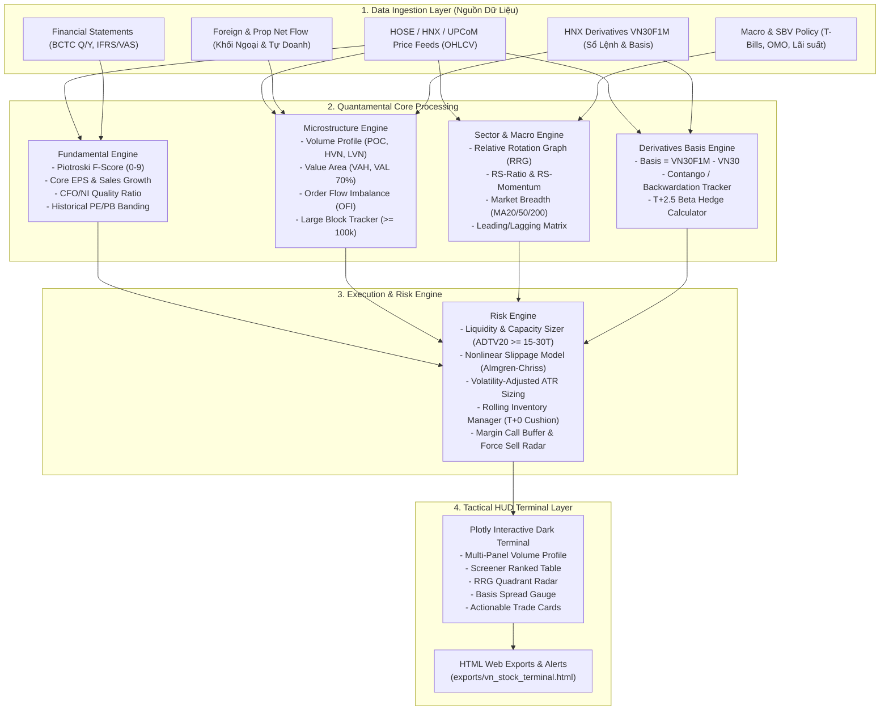

# Architecture: Neiro-Stock-VN Architecture Overview

## 1. Toàn Cảnh Kiến Trúc Hệ Thống (System Architecture)

Neiro-Stock-VN được thiết kế theo mô hình kiến trúc phân lớp độc lập (Layered Decoupled Architecture), tối ưu hóa cho môi trường vận hành nhẹ (< 15MB), không yêu cầu hạ tầng server cồng kềnh, chạy mượt mà trên cả máy tính cá nhân lẫn môi trường CI/CD Cloud (GitHub Actions / Colab).

---

## 2. Chi Tiết Các Tầng Xử Lý (Layer Breakdown)

### 2.1. Tầng Thu Thập & Chuẩn Hóa Dữ Liệu (`src/collector/`)
- **`vn_market_client.py`:** Đầu mối tích hợp API chuẩn hóa dữ liệu từ các nền tảng tài chính Việt Nam (VNDirect, Vietstock, TCBS, SSI, FiinTrade hoặc thư viện mã nguồn mở `vnstock`). Hỗ trợ cơ chế failover dự phòng và mock benchmark data cho unit tests.
- **`data_loader.py`:** Làm sạch dữ liệu, xử lý các sự kiện chia tách cổ tức, tăng vốn, thưởng cổ phiếu; chuyển đổi cấu trúc BCTC chuẩn VAS về dataclasses định lượng nhất quán.
- **`fialda_scanner.py`:** Khai thác chuyên sâu hệ thống **Fialda VIP Expert & Swagger API** (529 endpoints):
  - Tự động xác thực JWT Token (`/api/TokenAuth/Authenticate`) với chu kỳ hiệu lực 24 giờ.
  - Thu thập tín hiệu AI Expert: Chờ Mua Chân Sóng (`GetTinHieuChoMuaNew`), Đột biến Giá trị giao dịch (`GetTinHieuDotBienGiaTri`).
  - Trích xuất bộ chỉ số định chế IBD O'Neil: Sức mạnh giá RS 1 tháng (`rS1M`), Điểm tổng hợp (`compositeRating`), Hệ số Tích lũy/Phân phối (`accDissRating`).
  - Nạp toàn bộ ma trận luân chuyển dòng tiền RRG 1,530 mã toàn thị trường (`GetRRGData`).
  - Lọc đa biến chọn lọc **Top 5 Siêu cổ phiếu bứt phá chân sóng** (khung 1 tháng, biên lợi nhuận kỳ vọng $+20\% - +35\%$, cắt lỗ chặt chẽ $-5.5\%$).

### 2.2. Tầng Định Lượng Cơ Bản (`src/fundamental_engine/`)
- **`screener.py`:** Bộ lọc đa biến lọc ra Top $10\% - 15\%$ doanh nghiệp chất lượng cao nhất toàn sàn:
  - Lọc sơ bộ vốn hóa: Market Cap $\ge 1,000$ tỷ VND, Khối lượng trung bình 20 phiên $\ge 200,000$ cp/phiên (loại bỏ cổ phiếu penny thanh khoản rác).
  - Điểm số tài chính Piotroski F-score $\ge 7/9$.
  - Chất lượng dòng tiền: $CFO / Net Income > 1.0$.
- **`valuation.py`:** Tính toán dải định giá phân vị lịch sử 3 năm (P/E Percentile Band, P/B Percentile Band), xác định vùng tích lũy rẻ định chế.

### 2.3. Tầng Cấu Trúc Vi Mô & Sổ Lệnh (`src/microstructure_engine/`)
- **`volume_profile.py`:** Thuật toán phân rã khối lượng giao dịch tích lũy theo từng bước giá (Price Bins):
  - Tính toán chính xác mức giá Point of Control (POC).
  - Vùng giá trị Value Area (VAH, VAL) chiếm $70\%$ khối lượng giao dịch.
  - Phân loại High Volume Nodes (HVN - Thành trì phòng ngự) và Low Volume Nodes (LVN / Air Pockets - Vùng chân không thanh khoản kích hoạt đà rơi/tăng tốc).
- **`order_flow.py`:** Đo lường tỷ lệ lệnh mua chủ động vs. bán chủ động ($OFI$), quét các lệnh khớp lô lớn $\ge 100,000$ cổ phiếu để xác định sự xuất hiện của Big Boys.
- **`basis_tracker.py`:** Theo dõi chênh lệch Basis giữa hợp đồng tương lai VN30F1M và chỉ số VN30 Index, nhận diện trạng thái Contango / Backwardation để dự báo điểm đảo chiều của thị trường cơ sở.

### 2.4. Tầng Luân Chuyển Ngành & Vĩ Mô (`src/sector_engine/`)
- **`rrg_rotation.py`:** Tính toán ma trận Relative Rotation Graph (RRG) cho 12 nhóm ngành chủ lực của nền kinh tế Việt Nam (Ngân hàng, Bất động sản, Thép, Chứng khoán, Bán lẻ, Hóa chất, Dầu khí, Đầu tư công, Điện nước, CNTT, Thủy sản, Dệt may).
  - Phân loại ngành vào 4 góc phần tư: Leading, Weakening, Lagging, Improving.
- **`market_breadth.py`:** Đo lường độ rộng thị trường (tỷ lệ cổ phiếu trên MA20, MA50, MA200, đường Advance-Decline Line) để phát hiện sớm các hiện tượng "kéo trụ xả danh mục" (Green Index - Red Market).

### 2.5. Tầng Quản Trị Rủi Ro & Vị Thế T+2.5 (`src/risk_engine/`)
- **`liquidity_sizer.py`:** Bộ lọc thanh khoản và mô hình sức chứa danh mục quy chuẩn Quỹ:
  - Sàng lọc ADTV20 $\ge 15.0 - 30.0$ tỷ đồng/phiên (loại bỏ hoàn toàn cổ phiếu penny/illiquid).
  - Khống chế quy mô vị thế không quá $10\% - 15\%$ ADV20, làm tròn chuẩn lô 100 cổ phiếu, kiểm soát thời gian thanh lý an toàn trong chu kỳ T+2.5 ($ExitDays \le 1.0$ ngày).
  - Ước lượng trượt giá phi tuyến theo quy mô lệnh: $\text{Slippage} = \text{Spread} + k \times (\text{Size}/\text{ADTV})^\alpha$, phát tín hiệu cảnh báo trực tiếp trên Terminal khi quy mô vượt sức chứa chịu đựng.
  - Chấm điểm thanh khoản đa biến (0 - 100 điểm) phân cấp độ an toàn dòng tiền.
- **`position_sizer.py`:** Tính toán quy mô giải ngân an toàn dựa trên rủi ro biến động $ATR(14)$ của cổ phiếu, khống chế mức lỗ tối đa cho mỗi vị thế không vượt quá $1.5\% - 2.0\%$ tổng NAV tài khoản.
- **`t25_manager.py`:** Quản trị vòng quay hàng sẵn có (Rolling Inventory), thiết lập cơ chế khóa lợi nhuận hoặc phòng hộ danh mục bằng HĐTL VN30F1M khi thị trường vi phạm các mốc thanh khoản trọng yếu.

### 2.6. Tầng Kiểm Định Quá Khứ (`src/backtesting/`)
- **`models.py`:** Cấu trúc dữ liệu mô phỏng khớp lệnh: `Exchange` (HOSE 7%, HNX 10%, UPCoM 15%), `PriceBand`, `SettlementBatch`, `Position`, `TradeRecord`, `BacktestConfig`, `BacktestResult`.
- **`engine.py` (`T25BacktestEngine`):** Lõi mô phỏng thực thi lệnh với ràng buộc khắt khe của TTCK Việt Nam:
  - Hàng đợi `SettlementQueue`: Mua tại $T$ chỉ được bán từ chiều ngày $T+2$ (hoặc từ $T+3$ trở đi).
  - Kiểm tra biên độ trần/sàn: Từ chối lệnh mua nếu vượt trần (trắng bên bán), từ chối lệnh bán nếu dưới sàn (mất thanh khoản).
  - Khấu trừ chi phí thực tế: $0.15\%$ phí mua, $0.15\%$ phí bán $+ 0.10\%$ thuế bán chứng khoán (tổng $0.40\%$).
  - Khớp lệnh tại $t+1$ (giá Open/ATO) để triệt tiêu hoàn toàn Look-ahead Bias.
- **`point_in_time.py` (`PointInTimeDatabase`):** Đảm bảo BCTC chỉ được đưa vào tính Piotroski F-score và CAMEL sau ngày nộp chính thức (`filing_date`), triệt tiêu Point-in-Time Bias.
- **`metrics.py`:** Bộ công thức toán học đo lường hiệu suất định chế: CAGR, Sharpe, Sortino, Max Drawdown, Calmar, Win Rate, Profit Factor, Walk-Forward Efficiency (WFE).
- **`walk_forward.py` (`WalkForwardCoordinator`):** Điều phối kiểm định độc lập giữa tập In-Sample (2021-2023) và Out-of-Sample (2024-2026), tính tỷ số WFE chứng minh hệ thống không bị Overfitting.

### 2.7. Tầng Giao Diện Tác Chiến (`src/hud/`)
- **`terminal.py`:** Sinh mã nguồn HTML tương tác đa tab hoàn chỉnh, hỗ trợ Dark Mode hiện đại, bao gồm:
  - Tab 1: Top 20 Siêu Cổ Phiếu Chân Sóng & Bảng Xếp Hạng Định Lượng Cơ Bản (Piotroski F-Score).
  - Tab 2: Kiểm Định Lịch Sử T+2.5 Walk-Forward (Biểu đồ đường cong vốn SVG siêu nét Strategy vs VN-Index Benchmark, Bảng so sánh In-Sample vs Out-of-Sample, Nhật ký giao dịch thực chiến).
  - Tab 3: Bảng Định Lượng Ngân Hàng Thương Mại CAMEL & Basel II/III.
  - Tab 4: Báo Cáo Kết Quả Kinh Doanh BCTC & Tin Tức Doanh Nghiệp Spotlight.
  - Hệ thống Tab Navigation tương tác chuyển đổi mượt mà không cần tải lại trang.

### 2.8. Tầng Tự Động Hóa & Đám Mây CI/CD (`.github/workflows/`)
- **`ci.yml`:** Quality Gate tự động chạy trên mọi Pull Request và Push to `main`, kiểm thử 100% pytest và kiểm tra giới hạn dung lượng Zero-Waste (< 15MB).
- **`scanner_and_pages.yml`:** Quy trình tự động hóa tác chiến 24/7 trên GitHub Actions:
  - Tự động kích hoạt định kỳ 30 phút/lần trong giờ giao dịch (09:15 - 11:45 và 13:15 - 15:05).
  - Hỗ trợ `workflow_dispatch` cho phép kích hoạt thủ công từ điện thoại bất kỳ lúc nào.
  - Đăng nhập Fialda VIP qua GitHub Secrets, quét Top 5 và sinh giao diện HTML.
  - Xuất bản bảng kết quả tức thì vào **GitHub Step Summary** trên ứng dụng di động.
  - Tự động deploy dashboard lên **GitHub Pages** (`exports/index.html`) để xem trực tuyến mọi lúc mọi nơi.

---

## 3. Quản Lý Bộ Nhớ & Tiêu Chuẩn Zero-Waste

- **Zero Memory Leak:** Toàn bộ các cấu trúc dữ liệu chuỗi thời gian đều được ép kiểu `float32` hoặc `int32` trong Pandas/NumPy, tránh phát sinh overhead bộ nhớ.
- **Tự động dọn dẹp Cache:** Các tệp cache dữ liệu tạm thời trong `data/` được giới hạn kích thước và tự động dọn sạch sau khi hoàn tất pipeline kiểm thử.
- **Tổng dung lượng toàn bộ repository:** Đảm bảo duy trì dưới mức **15MB**, bảo vệ tối đa dung lượng ổ cứng của người dùng.
