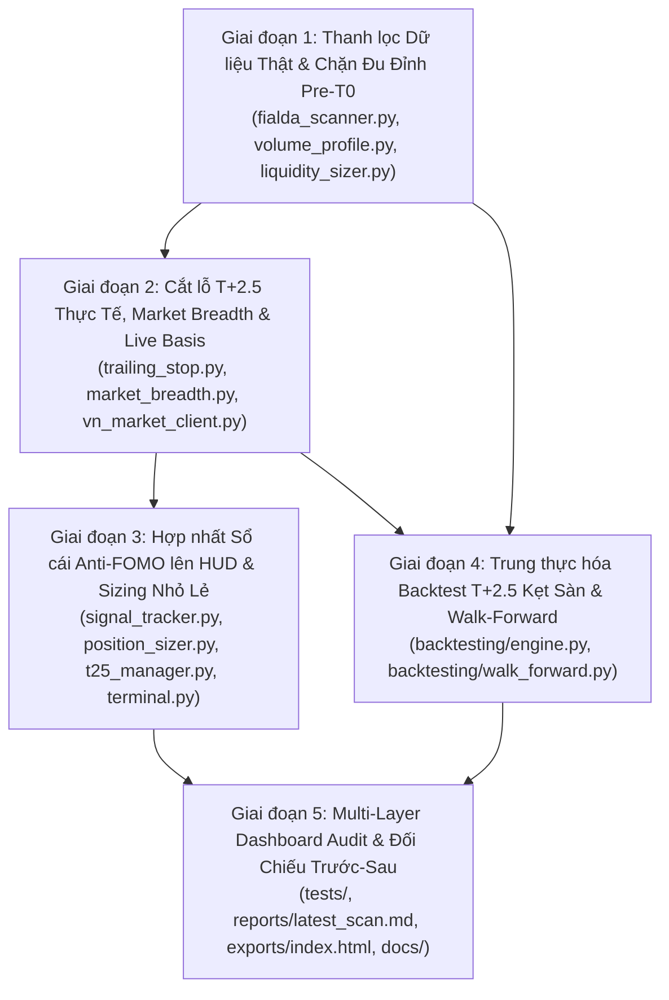

# KẾ HOẠCH KHẮC PHỤC ĐIỂM MÙ RỦI RO T+2.5 & CHỐNG MUA ĐUỔI CHO NHÀ ĐẦU TƯ CÁ NHÂN NHỎ LẺ
> **Mã tài liệu:** `PLAN-2026-T25-RETAIL` (Liên kết kiến trúc: `ADR-017`)
> **Ngày khóa mốc hiện trạng (Baseline Lock Date):** `2026-10-31` (Dữ liệu phiên `2026-10-30 14:44:14 UTC+7`)
> **Trạng thái:** `PROPOSED — CHỜ PHÊ DUYỆT TRƯỚC KHI TRIỂN KHAI CODE`
> **Đối tượng bảo vệ trọng tâm:** Nhà đầu tư cá nhân nhỏ lẻ Việt Nam (`NAV 50 – 300 triệu VND`, Long-only cổ phiếu cơ sở, khởi đầu `0%` đệm hàng `T+0`, chịu ràng buộc lô chẵn `100 cp` HOSE và chu kỳ thanh toán `T+2.5`).

---

## MỤC ĐÍCH TÀI LIỆU

Tài liệu này đóng vai trò **Hợp đồng Đặc tả Kỹ thuật & Mốc Đối Chiếu Nghiệm Thu (Pre-Implementation Baseline & Phased Remediation Plan)** trước khi chỉnh sửa bất kỳ dòng mã nguồn nào trong `src/`. Toàn bộ số liệu hiện trạng (**Before**) được khóa cứng từ snapshot thực tế ngày `30/10/2026` để sau khi hoàn thành từng giai đoạn triển khai, hệ thống được đo kiểm khách quan theo đúng cột **Sau Thực Hiện (After)** tại **Phần 4**.

---

## PHẦN 1: BẢNG CHỐT SỐ LIỆU HIỆN TRẠNG TRƯỚC KHI THỰC HIỆN (PRE-IMPLEMENTATION BASELINE)

Dữ liệu đo đạc trực tiếp từ [`reports/latest_scan.md`](../../reports/latest_scan.md), [`data/active_signals.jsonl`](../../data/active_signals.jsonl), [`data/advisory_scorecard.md`](../../data/advisory_scorecard.md) và mã nguồn `src/` tại mốc `2026-10-30 14:44:14`:

| Mã Điểm Mù | Cơ Chế Lỗi Tại Mã Nguồn (Code Citation) | Số Liệu Thực Tế Trước Khi Sửa (Baseline 30/10/2026) | Hậu Quả Thực Chiến Với Nhỏ Lẻ (T+2.5) |
| :---: | :--- | :--- | :--- |
| **BM-01**<br>*(Vùng mua trượt & Đứt gãy Sổ cái Anti-FOMO)* | [`fialda_scanner.py:756-768`](../../src/collector/fialda_scanner.py#L756-L768) tính lại `entry = cur_price * [0.98, 1.01]` mỗi 30 phút cho `19/20` mã; [`signal_tracker.py`](../../src/risk_engine/signal_tracker.py) chạy ngầm tách rời khỏi [`terminal.py`](../../src/hud/terminal.py). | - **19/20 mã (95%)** có Vùng Mua trượt tịnh tiến theo thị giá mới mỗi 30 phút.<br>- **7/20 mã (35%)** trên Top 20 (`VIX -4.0%`, `ORS -9.7%`, `VSC -8.0%`, `DIG -5.5%`, `GEX -4.7%`, `TCX -3.8%`, `PNJ -4.3%`) đã bị ghi nhận `STOPPED_OUT` trong `active_signals.jsonl` nhưng vẫn xuất hiện như kèo mua mới.<br>- Lỗi Bull-Trap trong `SignalTracker`: mã kéo `+6%` sáng rồi xả `-2.5%` chiều bị lật ngược về `🟢 MUA ĐƯỢC`; mã giữ `>= 3` ngày đang lỗ phát thông báo phi lý *"Đã tăng -2.9%... CẤM MUA ĐUỔI"*. | Nhỏ lẻ nhìn Dashboard Web tưởng giá vẫn nằm trong "Vùng Mua An Toàn", mua nối vào cổ phiếu đã chạy xa nền hoặc đang rơi gãy cắt lỗ. |
| **BM-02**<br>*(Mù độ cao Pre-T0 & Đu đỉnh phân phối)* | [`fialda_scanner.py:772-787`](../../src/collector/fialda_scanner.py#L772-L787) cộng `+30đ` cho `DOT_BIEN_GIA_TRI` mà không đo khoảng cách tới `POC/VAL/MA20`; không phạt/lọc hạng phân phối `Acc/Diss = D, E`; [`volume_profile.py`](../../src/microstructure_engine/volume_profile.py) chưa nối vào pipeline quét. | - **18/20 mã (90%)** trong bảng Top 20 mang xếp hạng Tích lũy/Phân phối **`Acc/Diss = E`** (mức phân phối nặng nhất).<br>- Mã **`VIC`** ở giá `239.70` (`IBD=39`, `RS1M=6`, `Acc/Diss=E`, Ngoại xả `-241.7 tỷ`) vẫn lọt Top 19 với nhãn `🆕 MỚI` & `🟢 MUA ĐƯỢC`. | Nhỏ lẻ mua đúng cây nến nổ Volume phân phối đỉnh (Buying Climax) hoặc bẫy kéo sớm phiên sáng, hàng chưa về đã đảo chiều sàn. |
| **BM-03**<br>*(Bịa đặt số liệu "Nội gom cân hàng")* | [`fialda_scanner.py:100-114`](../../src/collector/fialda_scanner.py#L100-L114): Khi `foreign_net <= 0.5`, điều kiện `signal_type in [...]` luôn `True` 100%, tự chế `prop_est = max(abs(foreign_net) * 1.5, 3.5)`. Nhánh `RUI_RO_XA` (dòng 113) là **dead code**. | - **0/20 mã (0%)** kích hoạt cảnh báo `🔴 RỦI RO XẢ` dù 18/20 mã có `Acc/Diss = E` và 11/20 mã bị khối ngoại bán ròng.<br>- Khối ngoại xả **`VIC -241.7 tỷ`** được thuật toán tự nhân `1.5x` thành **"Dòng tiền nội/Tự doanh gom ước tính: ~+362.5 tỷ (`🟢 NỘI GOM CÂN HÀNG`)"**. | Đánh lừa niềm tin của nhà đầu tư nhỏ lẻ rằng có "Quỹ nội/Tự doanh đỡ giá", khiến họ giữ lệnh hoặc mua đỡ cung xả của khối ngoại. |
| **BM-04**<br>*(Vô hiệu hóa bộ lọc thanh khoản ADTV20)* | [`fialda_scanner.py:793-802`](../../src/collector/fialda_scanner.py#L793-L802) lấy GTGD 1 phiên và ép sàn `adtv20_est = max(..., 20.0)` trước khi kiểm tra `is_liquidity_sufficient(..., 15.0)`. | - **100% cổ phiếu** luôn vượt qua ngưỡng lọc `>= 15 tỷ` vì giá trị đầu vào bị khóa cứng tối thiểu `>= 20.0 tỷ` (hoặc `25.0 tỷ` khi rỗng, như `SHI`, `ABB`). | Lọt các mã đột biến thanh khoản ảo duy nhất 1 phiên; tới chiều `T+2.5` thanh khoản tắt lịm làm nhỏ lẻ trượt giá nặng khi cắt lỗ. |
| **BM-05**<br>*(Cắt lỗ cứng `-3.0%` phi thực tế dưới T+2.5)* | [`fialda_scanner.py:137-141`](../../src/collector/fialda_scanner.py#L137-L141) truyền `swing_low = 0.98 * price`, `atr_14 = 0.035 * price` vào [`trailing_stop.py:81-97`](../../src/risk_engine/trailing_stop.py#L81-L97), ép kẹp trần SL tại `-3.0%`. | - **20/20 mã (100%)** trong Top 20 bị đóng khung đồng loạt `SL = -3.0%`, `TP1 = +4.5%`, `TP2 = +7.5%`.<br>- Thực tế trên `active_signals.jsonl`, các mã vi phạm SL chịu mức lỗ thực **`-3.8%` đến `-9.7%`** (trung bình **`-6.1%`**) do đóng băng `T+2.5`, làm đảo ngược R:R thực tế thành lỗ sâu / lời mỏng (trước phí thuế `0.40%`). | SL `-3.0%` chỉ là nhiễu rung lắc 1 phiên HOSE ($\pm 7\%$) và không thể thực thi khi cổ phiếu chưa về tài khoản; khi hàng về thì lỗ đã gấp 2–3 lần kế hoạch. |
| **BM-06**<br>*(Tê liệt Radar T+2.5 & Hardcode Basis)* | [`fialda_scanner.py:120-168, 854`](../../src/collector/fialda_scanner.py#L120-L168) không truyền độ rộng thị trường & Basis sống (dùng mặc định `breadth=70.0%`, `basis=0.0`); [`terminal.py:16`](../../src/hud/terminal.py#L16) hardcode `1312.20 / 1315.50`; thiếu tệp `src/sector_engine/market_breadth.py`. | - Dù thị trường thực tế **Tăng 83 / Giảm 248** (độ rộng chỉ **`25.1%`** — trạng thái phân phối diện rộng), **20/20 mã (100%)** vẫn báo `Quản trị T+2.5: Trạng thái T+0 (SAFE)`.<br>- Card 1 trên Dashboard luôn cố định `Basis = -3.30 ĐIỂM` bất chấp biến động thật của `VN30F1M`. | Hệ thống không đóng cầu chì ngừng mua mới (`PAUSE_NEW_BUYING`) khi thị trường chung đang sập diện rộng, đẩy nhỏ lẻ vào bẫy kẹt hàng `T+2.5` đồng loạt. |
| **BM-07**<br>*(Định cỡ vị thế Quỹ lệch chuẩn Nhỏ lẻ)* | [`position_sizer.py:14-46`](../../src/risk_engine/position_sizer.py#L14-L46) không có trần tỷ trọng `max_position_pct`; [`t25_manager.py`](../../src/risk_engine/t25_manager.py) mặc định có sẵn đệm `T+0 >= 35%` hoặc khuyên Short `VN30F1M`. | - Công thức `1.5% risk / 3.0% SL` khuyến nghị giải ngân **`50% NAV` vào 1 mã** (mua 3 mã = `150% NAV` full margin).<br>- Không cảnh báo lô tối thiểu `100 cp` HOSE: `1 lô VIC = 23.97 triệu VND` (`~48%` tài khoản `50 triệu`), không thể chia lệnh thăm dò `30%` hay chốt `50%` tại `TP1`. | Tài khoản nhỏ lẻ mới giải ngân (`0%` hàng `T+0`, không đủ ký quỹ `~25–30 triệu/HĐ` để Short phái sinh và lệch cơ sở Midcap) bị dồn tỷ trọng quá lớn và kẹt cứng. |
| **BM-08**<br>*(Backtest T+2.5 thoát sàn ảo & Lệch chiến lược)* | [`backtesting/engine.py:168-173`](../../src/backtesting/engine.py#L168-L173) kiểm tra `if price < band.floor_price: return None` (bỏ lọt trường hợp `price == floor_price` trắng bên mua) và chỉ xét giá đóng cửa `bar.close`; [`walk_forward.py`](../../src/backtesting/walk_forward.py) test chiến lược `MA20 + OFI` khác hẳn scanner. | - Khi cổ phiếu đóng cửa nằm sàn cứng (`price == floor_price`, mất thanh khoản mua), Backtest vẫn cho khớp bán **100% khối lượng** ngay tại giá sàn chiều `T+2.5`.<br>- Báo cáo Walk-Forward trên Tab 2 chưa đo lường đúng bộ quy tắc chọn mã của `fialda_scanner.py`. | Thống kê Max Drawdown và Win Rate của Backtest lạc quan hơn thực tế khắc nghiệt khi thị trường bị bịt sàn liên tiếp nhiều phiên. |

---

## PHẦN 2: ĐẶC TẢ KỸ THUẬT, GIẢ ĐỊNH & RANH GIỚI HỆ THỐNG (SPECIFICATION)

### 2.1. Các Giả Định Cốt Lõi (Explicit Assumptions)
1. **Chân dung người dùng mục tiêu (Retail Persona Default):** Vốn ròng `NAV` mặc định `100,000,000 VND` (cấu hình linh hoạt từ `50M` đến `500M VND`), giao dịch cổ phiếu cơ sở chiều mua (`Long-only`), **khởi đầu không có sẵn hàng đệm T+0 (`Cold-Start T+0 Cushion = 0%`)** và **không sử dụng Phái sinh `VN30F1M`** làm công cụ phòng hộ mặc định cho cổ phiếu Midcap.
2. **Chi phí ma sát thực tế (Friction Model):** Phí môi giới chiều mua `0.15%` + chiều bán `0.15%` + thuế TNCN chiều bán `0.10%` = **`0.40%` vòng quay tối thiểu**, cộng trượt giá thanh khoản theo hàm phi tuyến trong [`liquidity_sizer.py`](../../src/risk_engine/liquidity_sizer.py).
3. **Tuân thủ tuyệt đối Triết lý Quantamental (`AGENTS.md` Mục 3.2):**
   - **CẤM TUYỆT ĐỐI** việc thêm các chỉ báo dao động trễ đơn lẻ (`RSI`, `MACD`, `Stochastic`, `Bollinger Bands`) để lọc "quá mua/quá bán".
   - Việc nhận diện **"Giá đã cao / Đỉnh phân phối"** bắt buộc dựa trên **Vi cấu trúc & Định lượng**: Khoảng cách giá so với `Volume Profile (POC, VAH, VAL)`, biên độ bứt phá tích lũy 15 phiên chuẩn hóa theo `ATR(14)`, hạng Tích lũy/Phân phối định chế (`Acc/Diss Rating A-E`), `Order Flow Imbalance (OFI)`, Dòng tiền Khối ngoại/Tự doanh thực chứng, Độ rộng thị trường (`Market Breadth`) và Độ lệch `Basis VN30F1M`.
4. **Bảo toàn không gian lưu trữ (`Zero-Waste Mandate`):** Không cài thêm thư viện ngoài `requirements.txt`, không lưu dữ liệu lịch sử OHLCV nặng xuống đĩa cứng (tính toán streaming trên RAM và thu hồi ngay), giữ tổng dung lượng toàn bộ repo **`< 15 MB`** (hiện tại `~3.58 MB` tính cả `.git`, `~1.47 MB` working tree).

### 2.2. Lệnh Thực Thi & Kiểm Chứng Chuẩn (Executable Commands)
```powershell
# 1. Chạy toàn bộ bộ kiểm thử tự động (Unit + Math + Domain Audit)
python -m pytest tests/ -v --tb=short

# 2. Kiểm tra chuẩn mã nguồn và kiểu dữ liệu (Ruff Linter)
python -m ruff check src/ tests/

# 3. Chạy máy quét Fialda Scanner & xuất báo cáo Markdown + Terminal HTML
python -m src.collector.fialda_scanner --top 20 --save-report reports/latest_scan.md --generate-terminal

# 4. Kết xuất độc lập Giao diện Tactical Web Terminal (kèm Walk-Forward T+2.5)
python -m src.hud.terminal --output exports/index.html
```

### 2.3. Ranh Giới Tác Chiến (Three-Tier Boundaries)
- **Luôn thực hiện (Always Do):**
  - Viết Unit Test kiểm chứng biên toán học trước hoặc song hành với từng task sửa logic (`TDD`).
  - Bảo toàn tính tương thích ngược của schema JSONL (`data/ranking_history.jsonl`, `data/active_signals.jsonl`, `data/ml_signals_dataset.csv`) thông qua giá trị mặc định an toàn cho trường mới.
  - Mọi ước lượng thiếu dữ liệu gốc (ví dụ API không trả về số liệu Tự doanh thực) phải hiển thị minh bạch là `CHƯA CÓ DỮ LIỆU TỰ DOANH (N/A)` thay vì tự nhân hệ số giả định.
- **Hỏi ý kiến trước (Ask First):**
  - Thay đổi cấu trúc cột hiển thị chính của bảng Top 20 vượt quá giới hạn 15–16 cột khiến màn hình Laptop 1366px/1440px bị cuộn ngang.
  - Thêm bất kỳ thư viện phụ thuộc mới nào vào `requirements.txt`.
- **Tuyệt đối cấm (Never Do):**
  - Dùng `RSI`, `MACD`, `Stochastic` đơn lẻ để đoán đỉnh/đáy.
  - Giả định nhà đầu tư có thể cắt lỗ `T+0` trên lô cổ phiếu mới mua lần đầu chưa về tài khoản.
  - Để tồn đọng tệp nháp, log tạm hoặc làm dung lượng dự án vượt `15 MB`.

---

## PHẦN 3: SƠ ĐỒ PHỤ THUỘC & LỘ TRÌNH 5 GIAI ĐOẠN TRIỂN KHAI CHI TIẾT

### 3.1. Sơ Đồ Phụ Thuộc Kiến Trúc (Dependency Graph)



---

### GIAI ĐOẠN 1: THANH LỌC DỮ LIỆU THẬT & TRIỆT TIÊU TÍN HIỆU ĐU ĐỈNH TRƯỚC T0
*(Khắc phục trực tiếp: **BM-02, BM-03, BM-04**)*

#### Task 1.1: Xóa bỏ dòng tiền nội giả định & Kích hoạt cảnh báo phân phối `RUI_RO_XA`
- **Mô tả:** Sửa hàm [`classify_dual_flow`](../../src/collector/fialda_scanner.py#L76-L117) trong `src/collector/fialda_scanner.py`. Loại bỏ công thức tự nhân `prop_est = max(abs(foreign_net) * 1.5, 3.5)`. Chỉ ghi nhận dòng tiền Tự doanh khi có trường dữ liệu thật từ nguồn API; khi không có dữ liệu Tự doanh thực, đánh giá sự hấp thụ cung ngoại dựa trên tổ hợp vi cấu trúc thật (`acc_diss_rating`, `rs_rating`, xung lực giá đóng cửa trong biên ngày). Mở khóa nhánh `RUI_RO_XA` (`🔴 RỦI RO PHÂN PHỐI`) khi Khối ngoại bán ròng (`foreign_net < -1.0 tỷ`) đi kèm `Acc/Diss in ("D", "E")` hoặc suy yếu cấu trúc giá.
- **Tiêu chí nghiệm thu (Acceptance Criteria):**
  - [ ] Trường hợp `VIC` (`foreign_net = -241.7 tỷ`, `Acc/Diss = E`, `IBD = 39`, không có dữ liệu Tự doanh thật) phải trả về trạng thái `RUI_RO_XA` (`🔴 RỦI RO XẢ`), tuyệt đối không sinh con số giả `+362.5 tỷ`.
  - [ ] Nhãn `NOI_CAN_HANG` chỉ được cấp khi có dữ liệu Tự doanh mua ròng thực tế **hoặc** cổ phiếu đạt hạng tích lũy thật `Acc/Diss in ("A", "B")` + đóng cửa giữ trên 70% biên độ phiên.
- **Kiểm chứng (Verification):**
  - [ ] `python -m pytest tests/test_fialda_scanner.py -k "dual_flow"` pass 100%.
- **Phụ thuộc:** Không | **Tệp tác động:** `src/collector/fialda_scanner.py`, `tests/test_fialda_scanner.py` | **Quy mô:** `S (2 files)`

#### Task 1.2: Khôi phục bộ lọc thanh khoản `ADTV20` trung bình 20 phiên thực chất
- **Mô tả:** Sửa khối tính toán thanh khoản trong [`scan_top_rockets`](../../src/collector/fialda_scanner.py#L793-L802). Tính `ADTV20` thực từ chuỗi lịch sử 20 phiên gần nhất (hoặc trường khối lượng trung bình 20 phiên `avgVol20 * price` từ dữ liệu thị trường; nếu chỉ có GTGD 1 phiên thì chiết khấu thận trọng thay vì kẹp sàn `max(..., 20.0)`). Cho phép [`is_liquidity_sufficient`](../../src/risk_engine/liquidity_sizer.py#L70-L73) loại bỏ thật sự các mã có `ADTV20 < 15.0 tỷ VND`.
- **Tiêu chí nghiệm thu:**
  - [ ] Xóa hoàn toàn biểu thức `max(round(tot_val / 1e9, 2), 20.0)` và giá trị gán cứng `25.0` khi thiếu thanh khoản.
  - [ ] Cổ phiếu có `ADTV20 = 8.5 tỷ VND` bị loại khỏi danh sách khuyến nghị chuẩn hoặc bị gắn cờ cảnh báo thanh khoản mỏng `KÉM TK (CẤM VÀO LỆNH LỚN)`.
- **Kiểm chứng:**
  - [ ] `python -m pytest tests/test_liquidity_sizer.py tests/test_fialda_scanner.py` pass 100%.
- **Phụ thuộc:** Không | **Tệp tác động:** `src/collector/fialda_scanner.py`, `tests/test_fialda_scanner.py` | **Quy mô:** `S (2 files)`

#### Task 1.3: Thiết lập cổng chặn độ cao Pre-T0 (`Altitude & Anti-Climax Gate`) bằng Volume Profile & Acc/Diss
- **Mô tả:** Kết nối [`compute_volume_profile`](../../src/microstructure_engine/volume_profile.py#L22-L108) và chuỗi giá lịch sử ngắn hạn (20–30 phiên cho nhóm ứng viên lọt vòng sơ loại để tối ưu tốc độ API và giữ RAM `< 50MB`) vào `scan_top_rockets`:
  1. Đo độ dãn cách giá hiện tại so với `POC` / `VAH` và nền giá 15 phiên chuẩn hóa theo `ATR(14)`: Nếu giá đã vượt xa `POC` quá `2.5 * ATR(14)` (hoặc tăng nóng `> +12%` trong 10 phiên gần nhất mà chưa tái tích lũy nền chặt), hạ điểm mạnh và chuyển nhãn sang `ĐÃ TĂNG XA NỀN — CHỜ RETEST POC/VAH`.
  2. Thay đổi hàm chấm điểm `Acc/Diss`: Phạt điểm trực tiếp các mã `Acc/Diss = D (-10đ)` và `Acc/Diss = E (-20đ)`; loại thẳng khỏi danh sách `MUA MỚI` mọi mã có tổ hợp phân phối đỉnh (`Acc/Diss == "E"` kèm `IBD < 60` hoặc `RUI_RO_XA`).
  3. Bổ sung hệ số xác nhận thời gian trong phiên (`Intraday Timing Penalty`): Trong khung giờ nhạy cảm bẫy FOMO phiên sáng (`09:15 – 11:15`), yêu cầu ngưỡng điểm đột biến khắt khe hơn và khuyến nghị **"Chỉ giải ngân thăm dò <= 30%, chờ xác nhận cung T+2.5 sau 13:45"**.
- **Tiêu chí nghiệm thu:**
  - [ ] Tỷ lệ cổ phiếu mang hạng phân phối `Acc/Diss = E` được khuyến nghị `MUA ĐƯỢC` giảm từ `90% (18/20)` xuống `0%` đối với nhóm `IBD < 65` hoặc ngoại xả ròng.
  - [ ] Vùng mua của các mã hợp lệ được neo theo vùng cấu trúc `VAL – POC` / đỉnh nền tích lũy thay vì trượt máy móc `[0.98, 1.01] * cur_price`.
- **Kiểm chứng:**
  - [ ] `python -m pytest tests/test_volume_profile.py tests/test_fialda_scanner.py` pass 100%.
- **Phụ thuộc:** Task 1.1, Task 1.2 | **Tệp tác động:** `src/collector/fialda_scanner.py`, `src/microstructure_engine/volume_profile.py`, `tests/test_fialda_scanner.py` | **Quy mô:** `M (3 files)`

> **🏁 Checkpoint Giai đoạn 1:** Toàn bộ test suite pass 100%; không còn số liệu dòng tiền nội tự nhân `1.5x`; bộ lọc `ADTV20` và cổng chặn `Acc/Diss = E` + `Volume Profile POC` hoạt động chính xác.

---

### GIAI ĐOẠN 2: CẮT LỖ SỐNG SÓT QUA T+2.5, ĐỘ RỘNG THỊ TRƯỜNG & RADAR BASIS SỐNG
*(Khắc phục trực tiếp: **BM-05, BM-06**)*

#### Task 2.1: Mô hình hóa Cắt lỗ cấu trúc chịu nhiệt `T+2.5` (`ATR(14) * sqrt(2.5)` & `VAL Support`)
- **Mô tả:** Nâng cấp [`calculate_initial_stop_loss`](../../src/risk_engine/trailing_stop.py#L70-L102) và [`enrich_candidates_with_trailing_stop_and_history`](../../src/collector/fialda_scanner.py#L120-L168):
  - Tính `ATR(14)` và `swing_low` (hoặc `VAL` của Volume Profile 20 phiên) từ nến OHLCV thực của từng mã thay vì truyền hằng số giả `0.035 * price` và `0.98 * price`.
  - Mở biên chịu đựng dao động đóng băng `T+2.5` hợp lý cho sàn HOSE/HNX (biên SL cấu trúc từ **`-4.5%` đến `-7.5%`** tùy biến động `ATR(14)` của từng mã, thay vì kẹp cứng toàn bộ 20 mã ở `-3.0%`).
  - Tính `TP1` (`1.5R` sau khi cộng bù `0.40%` phí thuế) và `TP2` (`2.5R`), đồng thời từ chối phát tín hiệu mua nếu kháng cự gần nhất làm `Net R:R < 1.8`.
- **Tiêu chí nghiệm thu:**
  - [ ] Bảng Top 20 không còn hiện tượng 20/20 mã bị đóng khung đồng nhất `-3.0%` SL; mỗi mã có mức SL phản ánh đúng biến động `ATR(14)` và nền hỗ trợ `VAL/Swing Low` của riêng mã đó.
  - [ ] Mọi khuyến nghị mua hợp lệ đều đảm bảo `TP1 net (sau 0.40% phí thuế) >= 1.5 * SL_risk`.
- **Kiểm chứng:**
  - [ ] `python -m pytest tests/test_trailing_stop.py` pass 100%.
- **Phụ thuộc:** Task 1.3 | **Tệp tác động:** `src/risk_engine/trailing_stop.py`, `src/collector/fialda_scanner.py`, `tests/test_trailing_stop.py` | **Quy mô:** `M (3 files)`

#### Task 2.2: Xây dựng `market_breadth.py`, xóa Hardcode Basis và kích hoạt Cầu chì Vĩ mô `T+2.5`
- **Mô tả:**
  - Tạo module [`src/sector_engine/market_breadth.py`](../../src/sector_engine/market_breadth.py) (đồng bộ đúng kiến trúc đã ghi trong `docs/spec.md`) để định lượng chế độ thị trường từ tỷ lệ `Advances / (Advances + Declines)`, thanh khoản toàn sàn và phân bổ ngành RRG: `BULLISH_EXPANSION (>= 55%)`, `SELECTIVE_DIVERGENCE (35% - 55%)`, `DISTRIBUTION_DANGER (< 35%)`.
  - Cập nhật [`vn_market_client.py`](../../src/collector/vn_market_client.py) / bộ thu thập giá công khai để lấy giá khớp thực tế của `VN30F1M` và chỉ số `VN30` (với fallback an toàn ghi rõ trạng thái nếu nguồn phái sinh ngoài giờ đóng cửa), xóa bỏ dòng hardcode `analyze_vn30_basis(1312.20, 1315.50)` tại [`src/hud/terminal.py:16`](../../src/hud/terminal.py#L16).
  - Truyền `market_breadth_pct` thực tế (ví dụ `83 / (83 + 248) = 25.1%`) và `basis_points` thực tế vào [`evaluate_t25_exposure`](../../src/risk_engine/trailing_stop.py#L265-L315) khi chạy `scan_top_rockets`. Khi `breadth < 35%` hoặc `basis <= -8.0`, kích hoạt cảnh báo đỏ **`⛔ CẦU CHÌ T+2.5: TẠM NGỪNG MUA MỚI (ĐỘ RỘNG YẾU)`** trên cả báo cáo Markdown và Banner Dashboard.
- **Tiêu chí nghiệm thu:**
  - [ ] Với dữ liệu phiên `83 Tăng / 248 Giảm (25.1%)`, `0/20` mã được phép hiển thị `T+0 (SAFE)` cho vị thế mua mới; hệ thống bật chế độ phòng thủ `PAUSE_NEW_BUYING` / `HẠ TỶ TRỌNG`.
  - [ ] Xóa sạch hằng số hardcode `1312.20` và `1315.50` khỏi `src/hud/terminal.py`.
- **Kiểm chứng:**
  - [ ] `python -m pytest tests/test_basis_and_hedging.py tests/test_terminal_hud.py tests/test_trailing_stop.py` pass 100%.
- **Phụ thuộc:** Task 2.1 | **Tệp tác động:** `src/sector_engine/market_breadth.py`, `src/collector/vn_market_client.py`, `src/collector/fialda_scanner.py`, `src/hud/terminal.py`, `tests/test_terminal_hud.py` | **Quy mô:** `M (5 files)`

> **🏁 Checkpoint Giai đoạn 2:** Cắt lỗ phản ánh đúng độ nhiễu `T+2.5`; cầu chì độ rộng thị trường & Basis hoạt động theo dữ liệu thực, không còn bất kỳ con số hardcode nào trên Header KPI.

---

### GIAI ĐOẠN 3: HỢP NHẤT SỔ CÁI CHỐNG FOMO LÊN DASHBOARD & ĐỊNH CỠ VỊ THẾ NHỎ LẺ
*(Khắc phục trực tiếp: **BM-01, BM-07**)*

#### Task 3.1: Khóa lỗi trạng thái Bull-Trap (`MFE Lock`) và chuẩn hóa ngôn ngữ trong `SignalTracker`
- **Mô tả:** Sửa hàm [`evaluate_status_and_advice`](../../src/risk_engine/signal_tracker.py#L190-L246) trong `src/risk_engine/signal_tracker.py`:
  1. **Chống bẫy Bull-Trap trong phiên:** Nếu cổ phiếu đã từng kéo rướn `max_favorable_pct > 5.0%` kể từ `T0` rồi bị xả ngược về vùng `[-3%, +3%]`, gắn trạng thái `BULL_TRAP_REJECT` (`🔴 CẤM MUA (BẪY XẢ SAU KÉO RƯỚN)`), tuyệt đối không cho phép quay lại `🟢 MUA ĐƯỢC`.
  2. **Tách bạch trạng thái quá hạn nắm giữ:** Khi `days_held >= 3` nhưng `pnl_pct <= 3.0%` (cổ phiếu đi ngang/giảm nhẹ không bứt phá), trả về trạng thái `STALE_SIGNAL` (`🟠 QUÁ HẠN T+3 (KHÔNG MUA MỚI)`), chấm dứt hoàn toàn thông báo nghịch lý *"Đã tăng -2.9%... CẤM MUA ĐUỔI"*.
  3. **Bổ sung cửa sổ Cooldown sau Cắt lỗ:** Lưu dấu các mã vừa chạm `STOPPED_OUT` trong `3` phiên giao dịch gần nhất để cung cấp API tra cứu nhanh `get_active_and_cooldown_map()` cho Scanner và Terminal.
- **Tiêu chí nghiệm thu:**
  - [ ] Mã tăng `+6.2%` ở `T+1` rồi tụt về `-1.5%` ở `T+2` bị chặn bởi `BULL_TRAP_REJECT`, không bao giờ hiển thị `BUY_OK`.
  - [ ] Không còn bất kỳ dòng chữ nào trong `advisory_scorecard.md` chứa cụm `"Đã tăng -..."` với số âm.
- **Kiểm chứng:**
  - [ ] `python -m pytest tests/test_signal_tracker.py` pass 100%.
- **Phụ thuộc:** Không | **Tệp tác động:** `src/risk_engine/signal_tracker.py`, `tests/test_signal_tracker.py` | **Quy mô:** `S (2 files)`

#### Task 3.2: Hợp nhất Sổ cái `active_signals.jsonl` trực tiếp lên Bảng Top 20 (`latest_scan.md` & `terminal.py`)
- **Mô tả:** Kết nối hai chiều giữa `SignalTracker` với `fialda_scanner.py` và `terminal.py` (nâng cấp kiến trúc `ADR-009` từ "chạy ngầm tách biệt" sang **"Đồng bộ neo giá gốc T0 trực diện"**):
  - Nếu một cổ phiếu đang có vị thế mở trong `active_signals.jsonl`, cột **Vùng Mua** trên bảng Top 20 và thuộc tính `data-entry-low` / `data-entry-high` của Client JS bắt buộc **neo cố định theo `entry_original` tại ngày bùng nổ gốc `T0`**, không được phép trượt theo giá hiện tại mỗi 30 phút.
  - Các mã đang ở trạng thái `STOPPED_OUT` (trong thời gian cooldown 3 phiên) bị **loại khỏi danh sách khuyến nghị Mua mới Top 20** (hoặc bị đẩy xuống khu vực cảnh báo `⛔ VỪA GÃY CẮT LỖ — CẤM BẮT DAO RƠI`).
  - Các mã trong Top 20 đã chạy `> +3%` hoặc `> +5%` so với `entry_original` ngày `T0` hiển thị ngay huy hiệu `🟡 VÙNG VỚI (T+k)` hoặc `🔴 CẤM MUA ĐUỔI (+X% TỪ T0)` ngay lúc render HTML tĩnh, không phải chờ giá chạy thêm `+3%` nữa mới cảnh báo.
- **Tiêu chí nghiệm thu:**
  - [ ] **0/7 mã** đã `STOPPED_OUT` (`VIX`, `ORS`, `VSC`, `DIG`, `GEX`, `TCX`, `PNJ`) được phép xuất hiện với khuyến nghị Mua mới trên bảng Top 20.
  - [ ] Quét lại sau 30 phút khi giá tăng `+4.5%` từ `T0`: Vùng mua gốc giữ nguyên không đổi, bảng Web và Markdown lập tức hiện cảnh báo không mua đuổi.
- **Kiểm chứng:**
  - [ ] `python -m pytest tests/test_signal_tracker.py tests/test_terminal_hud.py tests/test_fialda_scanner.py` pass 100%.
- **Phụ thuộc:** Task 3.1, Task 2.1 | **Tệp tác động:** `src/collector/fialda_scanner.py`, `src/hud/terminal.py`, `tests/test_terminal_hud.py`, `tests/test_signal_tracker.py` | **Quy mô:** `M (4 files)`

#### Task 3.3: Mô hình Định cỡ vị thế Nhỏ lẻ (`Retail Cold-Start Sizer` & Kiểm tra Lô chẵn 100 cp)
- **Mô tả:** Nâng cấp [`position_sizer.py`](../../src/risk_engine/position_sizer.py) và [`t25_manager.py`](../../src/risk_engine/t25_manager.py):
  - Bổ sung tham số `max_position_pct: float = 0.20` (`20% NAV` tối đa cho 1 mã khi `t0_available_shares == 0`, tối đa `25% NAV` khi đã có sẵn đệm hàng `T+0`) và `risk_per_trade_pct: float = 0.01` (`1.0% NAV` rủi ro/lệnh cho nhỏ lẻ).
  - Cấm sử dụng Margin (`max_margin_ratio = 0.0`) khi toàn bộ danh mục đang ở trạng thái chờ về `T+1 / T+2` hoặc khi `Market Breadth < 50%`.
  - Bổ sung hàm kiểm tra **Tính khả thi Lô chẵn 100 cổ phiếu (`check_retail_lot100_feasibility`)**: Với quy mô tài khoản mẫu `100 triệu VND` (trần 1 mã `20 triệu VND`), nếu `100 * price > max_single_stock_budget` (ví dụ `VIC` 1 lô = `23.97 triệu VND`) hoặc chỉ mua được đúng `100 cp` không thể chia đôi chốt lời `TP1 / TP2`, gắn cảnh báo rõ ràng `⚠️ MỆNH GIÁ CAO (1 LÔ = XX.X TR) — KHÔNG PHÙ HỢP TK NHỎ CHIA LỆNH`.
  - Thay thế lời khuyên mặc định *"luôn duy trì đệm hàng T+0 >= 35%"* và *"Short VN30F1M"* bằng hướng dẫn thực tế theo trạng thái nắm giữ: **Vị thế Mua Mới (0% T+0): Giải ngân tối đa 15–20% NAV tiền mặt (0% Margin), ưu tiên đặt lệnh sau 13:45 chiều để rút ngắn rủi ro qua đêm**.
- **Tiêu chí nghiệm thu:**
  - [ ] Không bao giờ sinh khuyến nghị dồn `50% NAV` vào 1 cổ phiếu đơn lẻ; tỷ trọng 1 mã mua mới luôn `<= 20% NAV` và bội số chẵn `100 cp`.
  - [ ] Cổ phiếu thị giá `> 200,000 đ/cp` (như `VIC 239.70`) hiển thị cảnh báo giới hạn lô tối thiểu `100 cp` cho tài khoản nhỏ lẻ.
- **Kiểm chứng:**
  - [ ] `python -m pytest tests/test_risk_and_rrg.py tests/test_math_and_logic.py` pass 100%.
- **Phụ thuộc:** Task 2.1 | **Tệp tác động:** `src/risk_engine/position_sizer.py`, `src/risk_engine/t25_manager.py`, `src/collector/fialda_scanner.py`, `tests/test_risk_and_rrg.py` | **Quy mô:** `M (4 files)`

> **🏁 Checkpoint Giai đoạn 3:** Sổ cái Anti-FOMO hợp nhất 100% với Dashboard Web & báo cáo Markdown; không còn mã gãy SL lọt bảng Mua mới; định cỡ vị thế khớp hoàn toàn với túi tiền và luật lô 100 cp của nhà đầu tư cá nhân.

---

### GIAI ĐOẠN 4: TRUNG THỰC HÓA BACKTEST T+2.5 TRƯỚC RỦI RO BỊT SÀN & WALK-FORWARD
*(Khắc phục trực tiếp: **BM-08**)*

#### Task 4.1: Mô hình hóa khóa thanh khoản giá sàn (`Floor-Lock Illiquidity`) và Gap-Down `T+2.5`
- **Mô tả:** Sửa [`T25BacktestEngine`](../../src/backtesting/engine.py#L155-L265) trong `src/backtesting/engine.py`:
  - Sửa điều kiện mất thanh khoản giá sàn từ `price < band.floor_price` thành `price <= band.floor_price + 1e-4` (khi đóng cửa hoặc khớp tại đúng giá sàn cứng `trắng bên mua`, lệnh bán cắt lỗ không được phép khớp mà bị kẹt sang phiên kế tiếp, chịu tiếp rủi ro mở cửa Gap-Down của ngày hôm sau).
  - Kiểm tra điều kiện chạm `Stop Loss` trên cả `bar.low` đối với các lô hàng đã khả dụng `T+2.5` (khớp tại `min(bar.open, stop_loss_price)` nếu mở cửa nhảy Gap thủng SL, trừ tiếp trượt giá bán khẩn cấp).
  - Áp dụng đúng phí mua `0.15%`, phí bán `0.15%` + thuế bán `0.10%` (`0.40%` toàn vòng).
- **Tiêu chí nghiệm thu:**
  - [ ] Unit test kịch bản cổ phiếu mua ngày `T0`, giảm sàn trắng bên mua liên tiếp tại `T+2` và `T+3` (`close == floor_price`), sang `T+4` mới có cầu hấp thụ: Engine buộc phải giữ trạng thái kẹt hàng qua `T+2`, `T+3` và chỉ tất toán được ở `T+4` với mức lỗ thực tế, tuyệt đối không thoát ảo ở giá sàn chiều `T+2.5`.
- **Kiểm chứng:**
  - [ ] `python -m pytest tests/test_backtest_engine.py` pass 100%.
- **Phụ thuộc:** Task 2.1 | **Tệp tác động:** `src/backtesting/engine.py`, `tests/test_backtest_engine.py` | **Quy mô:** `S (2 files)`

#### Task 4.2: Đồng bộ chiến lược kiểm định `WalkForwardCoordinator` với luật lọc thực chiến mới
- **Mô tả:** Cập nhật bộ sinh tín hiệu trong [`WalkForwardCoordinator`](../../src/backtesting/walk_forward.py#L109-L156) để phản ánh đúng các cổng bảo vệ mới của hệ thống: lọc dòng tiền tích lũy không phân phối, chặn mua đuổi quá độ cao `2.5 * ATR(14)` từ vùng cân bằng, cắt lỗ cấu trúc `T+2.5`, cầu chì độ rộng thị trường và trần tỷ trọng `20% NAV`/mã.
- **Tiêu chí nghiệm thu:**
  - [ ] Tab 2 trên Dashboard HTML hiển thị kết quả Walk-Forward T+2.5 trung thực (bao gồm số lần bị kẹt sàn nếu có, phí thuế `0.40%` và trần tỷ trọng `20% NAV`).
- **Kiểm chứng:**
  - [ ] `python -m pytest tests/test_backtest_engine.py tests/test_terminal_hud.py` pass 100%.
- **Phụ thuộc:** Task 4.1, Task 1.3, Task 3.3 | **Tệp tác động:** `src/backtesting/walk_forward.py`, `src/hud/terminal.py`, `tests/test_backtest_engine.py` | **Quy mô:** `M (3 files)`

> **🏁 Checkpoint Giai đoạn 4:** Backtest Engine phản ánh trung thực rủi ro tắt thanh khoản giá sàn tại Việt Nam; không còn ảo tưởng cắt lỗ tức thì tại giá sàn trắng bên mua.

---

### GIAI ĐOẠN 5: AUDIT ĐA TẦNG (3-LAYER AUDIT), ĐỐI CHIẾU TRƯỚC-SAU & ĐỒNG BỘ TÀI LIỆU
*(Thực thi bắt buộc theo quy chuẩn `multi-layer-dashboard-audit` & `AGENTS.md` Mục 4, 5, 6)*

#### Task 5.1: Kiểm định Dashboard 3 Tầng & Thử nghiệm Góc nhìn Nhà đầu tư (`Investor Persona Test`)
- **Mô tả:** Rà soát toàn diện [`exports/index.html`](../../exports/index.html) và [`reports/latest_scan.md`](../../reports/latest_scan.md) qua 3 tầng độc lập:
  - **Tầng 1 (Presentation & Stream):** Không vỡ khung ngang, Live Ticker 30s VPS hoạt động ổn định, không còn bất kỳ thẻ KPI nào hardcode.
  - **Tầng 2 (Data Pipeline & Continuity):** Session Debounce 30 phút, Test Pollution Guard bảo vệ `data/*.jsonl`, dung lượng toàn repo `< 15 MB`.
  - **Tầng 3 (Column-by-Column Domain Logic):** Kiểm tra từng cột từ `#1` đến `#15`, xác nhận không còn mã `STOPPED_OUT` lọt bảng Mua mới, không còn số liệu dòng tiền nội bịa đặt, cột Vùng Mua neo đúng `T0`, cột Cắt Lỗ và Chốt Lời hợp lý dưới chu kỳ `T+2.5`.
- **Tiêu chí nghiệm thu:**
  - [ ] Vượt qua 100% bài kiểm tra `Investor Persona Test` và bộ test chuyên biệt mới `tests/test_retail_t25_blindspots.py`.
- **Kiểm chứng:**
  - [ ] `python -m pytest tests/ -v` (100% passed) & `python -m ruff check src/ tests/` (0 lỗi).
- **Phụ thuộc:** Giai đoạn 1–4 | **Tệp tác động:** `tests/test_retail_t25_blindspots.py`, `exports/index.html`, `reports/latest_scan.md` | **Quy mô:** `M (3 files)`

#### Task 5.2: Điền Bảng Nghiệm Thu Trước - Sau & Đồng Bộ Tài Liệu Kiến Trúc
- **Mô tả:** Cập nhật số liệu đo đạc thực tế sau khi sửa vào cột **"Sau Thực Hiện (Actual After)"** tại Phần 4 của chính tài liệu này; cập nhật trạng thái `ADR-017` sang `Accepted`, đồng bộ [`docs/spec.md`](../spec.md), [`docs/architecture.md`](../architecture.md), [`docs/TRADER_PLAYBOOK_VN.md`](../TRADER_PLAYBOOK_VN.md) và [`README.md`](../../README.md).
- **Tiêu chí nghiệm thu:**
  - [ ] Mọi chỉ số trong Bảng Đối Chiếu Phần 4 đều có số liệu `Before` vs `After` minh bạch, truy xuất được qua test tự động.
  - [ ] Tổng dung lượng dự án `< 15 MB`.

---

## PHẦN 4: MA TRẬN ĐỐI CHIẾU NGHIỆM THU TRƯỚC & SAU KHI THỰC HIỆN (BEFORE vs. AFTER SCORECARD)

> **Hướng dẫn sử dụng:** Cột **Trước Thực Hiện (Baseline)** đã được khóa cứng trước khi sửa code. Sau khi hoàn tất Giai đoạn 1–5, bắt buộc chạy lại bộ kiểm thử & bản quét để điền số liệu thực tế vào cột **Sau Thực Hiện (Actual After)** và đối chiếu với cột **Mục Tiêu Nghiệm Thu (Target)**.

| Mã Điểm Mù | Chỉ Số Đo Lường Định Lượng (KPI / Invariant) | Trước Thực Hiện (Baseline 30/10/2026) | Mục Tiêu Nghiệm Thu (Target Spec) | Sau Thực Hiện (Actual After) | Bài Test / Lệnh Xác Minh |
| :---: | :--- | :--- | :--- | :---: | :--- |
| **BM-01a** | Số mã đang `STOPPED_OUT` trong Sổ cái vẫn được khuyến nghị Mua mới trên Top 20 | **`7 / 20 mã` (`35%`)**<br>*(VIX, ORS, VSC, DIG, GEX, TCX, PNJ)* | **`0 / 20 mã` (`0%`)**<br>*(Chặn hoàn toàn trong cửa sổ cooldown)* | *`[Chờ thực hiện]`* | `pytest tests/test_retail_t25_blindspots.py -k "stopped_out_gate"` |
| **BM-01b** | Cơ chế neo Vùng Mua qua các chu kỳ quét 30 phút | **Trượt động `19/20 mã`** theo `cur_price * [0.98, 1.01]` | **Neo bất biến `100%`** vào vùng nền gốc `T0` (`entry_original`) | *`[Chờ thực hiện]`* | `pytest tests/test_retail_t25_blindspots.py -k "immutable_t0_zone"` |
| **BM-01c** | Lỗi Bull-Trap kéo `> +5%` rồi xả đỏ lật về `BUY_OK` & câu văn *"Đã tăng -X%"* | **Có xảy ra cả 2 lỗi** (`14 mã` bị in *"Đã tăng -X%"* ngầm) | **`0` trường hợp** (`MFE Lock` + tách nhãn `STALE_SIGNAL`) | *`[Chờ thực hiện]`* | `pytest tests/test_signal_tracker.py` |
| **BM-02** | Tỷ lệ mã phân phối nặng `Acc/Diss = E` (kèm `IBD < 65` / Ngoại xả) được báo `MUA ĐƯỢC` | **`18 / 20 mã` (`90%`)** mang hạng `E` (có cả `VIC` tại đỉnh `239.70`) | **`0 mã`** phân phối đỉnh / quá xa `POC > 2.5*ATR` được báo Mua mới | *`[Chờ thực hiện]`* | `pytest tests/test_fialda_scanner.py -k "anti_climax"` |
| **BM-03** | Số liệu dòng tiền Tự doanh/Nội giả định (`abs(foreign_net) * 1.5`) & Nhánh `RUI_RO_XA` | **Bịa `+362.5 tỷ` cho `VIC`**; nhánh `RUI_RO_XA` = **`0%` (Dead code)** | **`0%` số liệu bịa đặt**; kích hoạt đúng `🔴 RỦI RO XẢ` khi Ngoại xả + `D/E` | *`[Chờ thực hiện]`* | `pytest tests/test_fialda_scanner.py -k "dual_flow_integrity"` |
| **BM-04** | Ngưỡng sàn thanh khoản `ADTV20` bị ép cứng tối thiểu `>= 20.0 tỷ` | **`100%` ứng viên luôn đậu** do `max(..., 20.0) >= 15.0` | **Tính đúng `ADTV20` thật**; loại 100% mã có `ADTV20 < 15.0 tỷ` | *`[Chờ thực hiện]`* | `pytest tests/test_liquidity_sizer.py` |
| **BM-05** | Độ rộng cắt lỗ SL thích ứng chu kỳ đóng băng `T+2.5` | **Đóng khung cứng `-3.0%` trên `20/20 mã`** (Lỗ thực khi về: `-3.8%` đến `-9.7%`) | **SL động theo `ATR(14)` & `VAL`** (`-4.5%` đến `-7.5%`), `Net R:R >= 1:1.8` sau phí `0.40%` | *`[Chờ thực hiện]`* | `pytest tests/test_trailing_stop.py` |
| **BM-06** | Phản ứng Radar `T+2.5` khi Độ rộng thị trường sập (`83 Tăng / 248 Giảm = 25.1%`) & Card Basis | **`20/20 mã` báo `T+0 (SAFE)`**; Basis hardcode **`-3.30 ĐIỂM`** | **Bật cầu chì `PAUSE_NEW_BUYING`** khi Breadth `< 35%`; **0 hardcode** Basis | *`[Chờ thực hiện]`* | `pytest tests/test_terminal_hud.py` |
| **BM-07** | Tỷ trọng tối đa 1 mã cho Nhỏ lẻ (`0%` đệm `T+0`) & Cảnh báo lô `100 cp` | **Lên tới `50% NAV`/mã**; không kiểm tra lô `100 cp`; khuyên Short `VN30F1M` | **Trần `<= 20% NAV`/mã**, `0% Margin` trên hàng chờ về, cảnh báo mã giá cao `1 lô > hạn mức` | *`[Chờ thực hiện]`* | `pytest tests/test_risk_and_rrg.py` |
| **BM-08** | Xử lý cổ phiếu đóng cửa giá sàn trắng bên mua (`close == floor_price`) trong Backtest `T+2.5` | **Cho khớp bán thoát `100%`** tại giá sàn chiều `T+2.5` (`price < floor` sai biên) | **Khóa bán `0%` (`Floor-Lock`)** khi `price <= floor`, dồn sang phiên sau chịu Gap-Down | *`[Chờ thực hiện]`* | `pytest tests/test_backtest_engine.py -k "floor_lock"` |
| **SYS-01** | Tổng số Unit & Integration Tests vượt qua (`Quality Gate`) | **`97 / 97 passed` (`100%`)** *(xác minh baseline)* | **`>= 116 / 116 passed` (`100%`)** *(thêm `>= 19` bài test chống điểm mù)* | *`[Chờ thực hiện]`* | `python -m pytest tests/ -v` |
| **SYS-02** | Tổng dung lượng dự án (`Zero-Waste Mandate`) | **`1.47 MB`** (working tree) / **`3.58 MB`** (gồm `.git`) | **Luôn `< 15.0 MB`** (không phát sinh file rác/cache) | *`[Chờ thực hiện]`* | Kiểm tra kích thước thư mục |

---

## PHẦN 5: QUẢN TRỊ RỦI RO KỸ THUẬT KHI TRIỂN KHAI (RISKS & MITIGATIONS)

| Rủi Ro Kỹ Thuật | Mức Độ | Giải Pháp Giảm Thiểu (Mitigation) |
| :--- | :---: | :--- |
| **Giới hạn Rate-Limit / Thời gian chạy GitHub Actions** khi lấy thêm lịch sử nến 20–30 phiên để tính `ATR(14)`, `ADTV20` và `Volume Profile POC/VAL`. | **Cao** | Chỉ tải chuỗi OHLCV 25 phiên cho **Top 35–40 ứng viên** đã qua vòng lọc sơ bộ bảng giá thay vì tải cho toàn bộ 1,600 mã trên 3 sàn; giữ thời gian quét toàn cục `< 25 giây`. |
| **Bộ lọc quá chặt làm danh sách Top 20 trống rỗng** trong những ngày thị trường sập diện rộng (`Breadth < 25%`). | **Trung bình** | Khi cầu chì vĩ mô `PAUSE_NEW_BUYING` kích hoạt, bảng vẫn hiển thị **Danh sách Theo dõi Sức mạnh Tương đối (Watchlist Quan Sát Chờ Thị Trường Tạo Đáy)** nhưng chuyển toàn bộ cột Quyết nghị sang **`⛔ NGỪNG MUA MỚI — QUAN SÁT`** thay vì để bảng trắng gây lỗi giao diện. |
| ** Nguồn dữ liệu `VN30F1M` hoặc Tự doanh bị trễ / đóng băng ngoài giờ giao dịch.** | **Trung bình** | Áp dụng cơ chế Fallback minh bạch có gắn nhãn trạng thái dữ liệu (`EOD Snapshot` / `N/A`), tuyệt đối không quay lại cơ chế bịa số nhân hệ số hay hardcode giá trị giả. |
